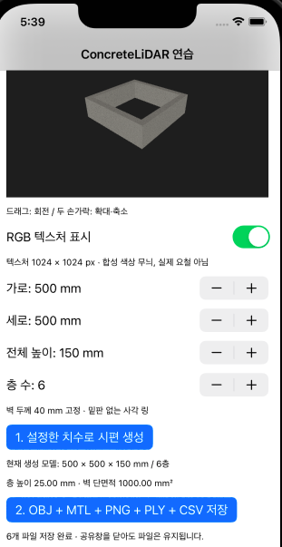
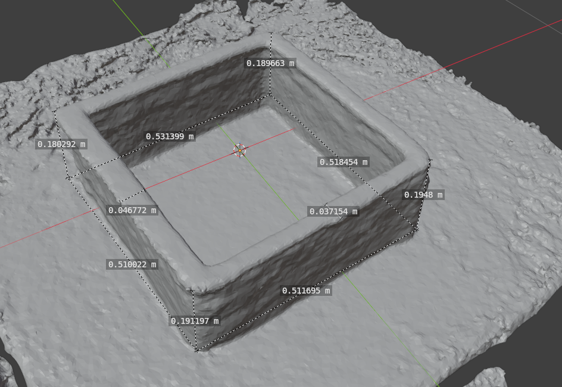
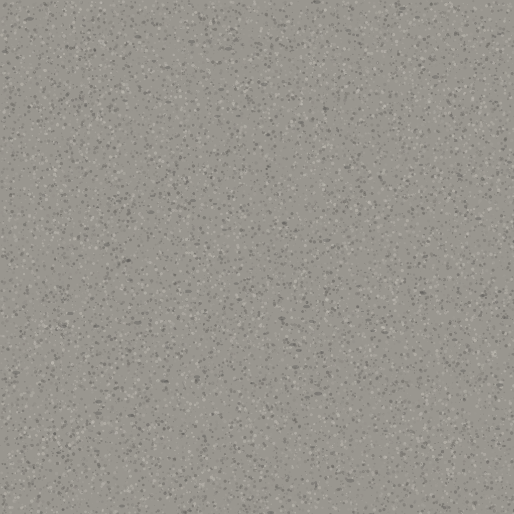

# ConcreteLiDAR-iOS

**스마트폰 LiDAR를 활용한 3D 프린팅 콘크리트 형상 측정 — Blender 측정 기록과 iOS 프로토타입**



*프로토타입의 실제 시뮬레이터 실행 화면입니다. 화면 속 시편과 텍스처는 가상으로 생성한 데이터입니다.*

이 저장소는 실물 시편을 Polycam으로 스캔하고 Blender에서 치수를 측정한 연구 기록과, 가상 적층 시편을 표시하는 초기 iOS 프로토타입 자료를 담고 있습니다.

> **현재 진행 상태:** 실물 시편의 측정 기록은 확보했으며, 기준 치수와 비교하는 정확도 검증은 진행 전입니다. Swift 소스와 Xcode 프로젝트는 아직 포함되어 있지 않습니다.

## 연구 목적

스마트폰 RGB–LiDAR를 활용하여 3D 프린팅 콘크리트의 적층 높이, 폭, 단면적과 형상 오차를 평가하는 방법을 연구합니다. 실물 시편의 재구성 메시를 측정하고, 가상 시편으로 파일 형식과 시각화 방식을 확인하여 향후 기준 치수와의 비교 실험을 준비합니다.

## 실물 시편의 Blender 측정 결과

**실물 시편 4개 · 치수 기록 32개 · Blender 화면 5장**

측정 기록에 따르면 네 시편 모두 **2026년 9월 14일** Polycam으로 촬영하고 GLTF 형식으로 내보냈습니다. 이후 Blender에서 재구성 메시의 치수를 측정했습니다. 아래 결과는 뒤에서 소개하는 가상 앱 예제와 구분되는 실물 시편 연구 기록입니다.



*P03 시편(IMG4): 모서리 높이 4개, 변 길이 4개, 벽체 두께 2개를 측정했습니다.*

[전체 측정값과 사진 5장 보기](research/blender-measurements/) · [측정 기록 엑셀 원본](research/blender-measurements/iphone-lidar-3dcp-measurements.xlsx)

| 시편 | 치수 기록 수 | 높이 범위 (mm) | 변 길이 범위 (mm) |
| --- | ---: | ---: | ---: |
| P01 | 4 | 182.530–188.387 | 521.420–531.639 |
| P02 | 8 | 138.320–153.652 | 510.924–521.241 |
| P03 | 10 | 180.292–194.800 | 510.022–531.399 |
| P04 | 10 | 110.582–117.409 | 527.003–538.684 |

P03은 벽체 두께 2개(37.154–46.772 mm), P04는 4개(24.416–30.559 mm)도 기록했습니다. 위 범위는 서로 다른 위치에서 측정한 치수의 최솟값과 최댓값이며, 정확도나 반복 측정 오차를 의미하지 않습니다. 기준 치수가 비어 있어 평균 절대오차(MAE), 평균제곱근오차(RMSE), 상대오차는 아직 산출하지 않았습니다. 사진 기준 위치명과 측정 방향의 정합 여부도 확인이 필요합니다.

## 가상 시편의 기본 형상

| 항목 | 설정값 |
| --- | ---: |
| 외측 폭 × 깊이 | 500 × 500 mm |
| 전체 높이 | 150 mm |
| 적층 수 | 6층 |
| 층 높이 | 25 mm |
| 벽체 두께 | 40 mm |

앱 실행 화면에는 사각 고리 형태의 콘크리트 모델, RGB 텍스처 전환, 치수 설정, 내보내기 버튼이 표시되어 있습니다. 시뮬레이터에서 보이는 모습과 Blender의 재질 표시가 일치하는지는 별도로 확인해야 합니다.

## 예제 데이터와 파일 형식

가상 시편 예제는 다음 파일로 구성됩니다.

- `synthetic_specimen.obj`: 메시 형상과 UV 좌표
- `synthetic_material.mtl`: 재질 연결 정보
- `synthetic_texture.png`: 절차적으로 생성한 1024 × 1024 RGB 표면 무늬
- `synthetic_specimen.ply`: 색상과 신뢰도 정보가 없는 XYZ 좌표 샘플
- `synthetic_measurements.csv`: 형상 설정으로 계산한 치수이며 실측값이 아님
- `DATA_NOTES.txt`: 원본 데이터의 생성 조건과 한계

파일은 [가상 시편 예제 폴더](examples/synthetic-specimen/)에서 확인할 수 있습니다. 재질 연결이 유지되도록 OBJ·MTL·PNG의 파일명을 바꾸지 않고 같은 폴더에 두세요.

### RGB 텍스처 미리보기



[OBJ 메시](examples/synthetic-specimen/synthetic_specimen.obj) · [PLY 좌표](examples/synthetic-specimen/synthetic_specimen.ply) · [RGB 텍스처 PNG](examples/synthetic-specimen/synthetic_texture.png)

## 프로젝트 구조

```text
ConcreteLiDAR-iOS/
├── README.md
├── .gitignore
├── research/
│   └── blender-measurements/
│       ├── README.md
│       ├── iphone-lidar-3dcp-measurements.xlsx
│       └── images/  (엑셀에 포함된 원본 사진 5장)
├── screenshots/
│   └── ios-simulator-preview.png
└── examples/
    └── synthetic-specimen/
        ├── synthetic_specimen.obj
        ├── synthetic_material.mtl
        ├── synthetic_texture.png
        ├── synthetic_specimen.ply
        ├── synthetic_measurements.csv
        └── DATA_NOTES.txt
```

## 프로토타입에서 확인되는 기능

| 항목 | 확인 가능한 자료 |
| --- | --- |
| 3D 시편 미리보기 | 시뮬레이터 실행 사진에서 확인 |
| 치수·적층 수 설정 | 폭, 깊이, 높이, 층 수 설정 화면 확인 |
| RGB 텍스처 표시 | 화면의 전환 버튼과 예제 PNG 제공 |
| 내보내기 화면 | OBJ·MTL·PNG·PLY·CSV 내보내기 버튼과 저장 상태 문구 확인 |
| 예제 출력 파일 | UV가 있는 OBJ, MTL–PNG 연결, XYZ 전용 PLY, 계산 치수 CSV 제공 |
| 앱 구현 재현 | Swift 소스와 Xcode 프로젝트 미제공 |

실행 사진은 앱 화면의 작동 모습을 보여줍니다. 다만 소스 코드가 없어 이 저장소만으로 앱을 빌드하거나 버튼 동작과 전체 내보내기 과정을 재현할 수는 없습니다.

## 가상 데이터의 한계

- 모델·텍스처·치수는 생성한 예제로, LiDAR나 카메라로 측정한 데이터가 아닙니다.
- PNG 무늬는 메시 면에 반복 적용됩니다. 무늬의 실제 크기는 보정되지 않았으며 형상 자체의 거칠기를 추가하지 않습니다.
- PLY에는 색상과 신뢰도 없이 XYZ 샘플 12,640개가 포함됩니다. 실제 센서에서 보이지 않는 이상화된 면도 포함하므로 가시성과 측정 잡음을 재현하지 않습니다.
- CSV의 치수는 형상 설정으로 계산한 값이며 측정 정확도의 근거가 아닙니다.
- 실제 촬영, RGB–깊이 정합, 치수 오차 평가는 기기 실험과 기준 치수 확보가 필요합니다.

원본 생성 조건은 [DATA_NOTES.txt](examples/synthetic-specimen/DATA_NOTES.txt)에 보존되어 있습니다.

## Blender에서 가상 시편 확인하기

1. OBJ·MTL·PNG를 원래 파일명 그대로 같은 폴더에 둡니다.
2. **파일 → 가져오기 → Wavefront (.obj)**에서 OBJ를 불러옵니다.
3. **재질 미리보기(Material Preview)**로 전환합니다.
4. 표면이 회색이면 재질의 **이미지 텍스처(Image Texture)** 노드를 확인하고, PNG를 **Principled BSDF → 기본 색상(Base Color)**에 연결합니다.

좌표 단위는 **미터(m)**입니다. X는 폭, Y는 높이, Z는 깊이이며 원점은 시편 바닥의 중심입니다. RGB 이미지는 외관만 바꾸며 형상의 거칠기를 추가하지 않습니다. PLY도 이상화된 모델 표면의 좌표이며 LiDAR 센서 시뮬레이션 결과는 아닙니다.

## 개발 및 연구 진행 상태

| 항목 | 상태 |
| --- | --- |
| 시뮬레이터 시각화 | 실행 사진으로 확인 |
| 가상 모델·텍스처 출력 | 예제 파일 제공, 구현 소스 미제공 |
| Blender의 RGB 텍스처 표시 | 검증 중 |
| Swift 소스·Xcode 프로젝트 | 저장소에 미포함 |
| Polycam·Blender 실물 시편 기록 | 시편 4개, 치수 32개, 사진 5장 수록 |
| 기준 치수와 비교한 정확도 검증 | 기준값 측정 대기 |
| 자체 iOS 앱의 실제 LiDAR 스캔 | 확인되지 않음 |

## 향후 계획

1. Swift·Xcode 원본 소스와 재현 가능한 빌드 방법을 추가합니다.
2. 앱과 Blender에서 RGB 텍스처가 일관되게 표시되는지 확인합니다.
3. 실제 센서 데이터와 구분하여 가상 표면 거칠기와 샘플링 잡음을 시험합니다.
4. 실물 시편의 동일 위치 기준 치수와 독립 반복 스캔을 확보하고, 측정 오차를 정량적으로 평가합니다.

**연구 방향:** 스마트폰 RGB–LiDAR를 활용한 3D 프린팅 콘크리트 적층 형상 측정의 적용성과 한계 평가
