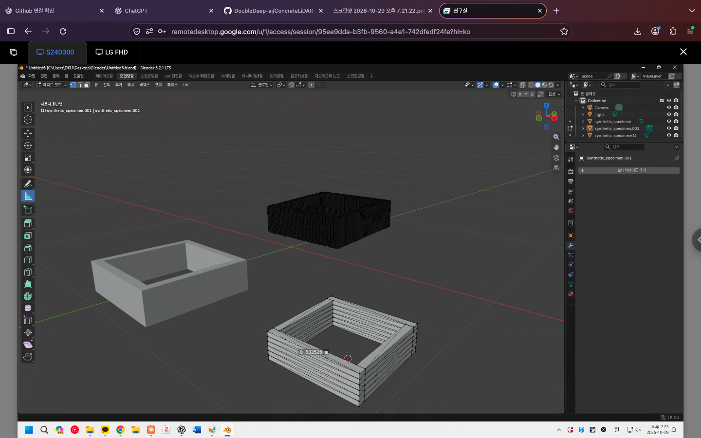

# ConcreteLiDAR-iOS

**스마트폰 RGB–LiDAR를 활용한 3D 프린팅 콘크리트 적층 형상 측정 연구**

실물 시편의 재구성 메시에서 치수를 측정하고, 가상 시편 앱으로 형상 생성·파일 저장·Blender 확인 과정을 시험합니다. 목표는 적층 높이·폭·단면 형상을 측정할 때 스마트폰 기반 방법의 적용 범위와 오차를 정량적으로 평가하는 것입니다.

## 현재까지의 결과

| 구분 | 수행 내용 | 확인 자료 |
| --- | --- | --- |
| 실물 시편 연구 | Polycam으로 촬영한 시편 4개의 높이·변 길이·두께 기록 32개 정리 | [Blender 사진 5장과 전체 측정값](research/blender-measurements/) |
| iOS 프로토타입 | 가상 시편 생성, 치수 설정, RGB 텍스처 생성·전환, 파일 저장 코드 | [Swift 소스](ios/ConcreteLiDARPractice/ContentView.swift) · [실행 방법](ios/README.md) |
| 데이터 내보내기 | OBJ·MTL·PNG·PLY·CSV 예제 구성 및 Blender 불러오기 화면 확보 | [예제 파일](examples/synthetic-specimen/) |
| 정확도 평가 | 동일 위치의 실물 기준 치수 확보 후 비교 예정 | [측정 기록 엑셀](research/blender-measurements/iphone-lidar-3dcp-measurements.xlsx) |

## 앱 실행 화면

*가상 시편 앱의 시뮬레이터 실행 화면. SwiftUI·SceneKit으로 형상을 표시하고 RGB 텍스처와 모델 파일을 생성합니다.*

## 실물 시편 측정

**Polycam 촬영 → GLTF 내보내기 → Blender 치수 측정 → 엑셀 기록**

측정 기록에 기재된 촬영일은 네 시편 모두 **2026년 9월 14일**입니다. Blender에서 재구성 메시의 모서리 높이, 변 길이, 벽체 두께를 측정했습니다.

*P03: 높이 4개, 변 길이 4개, 두께 2개. 위치명은 각 사진 기준입니다.*

| 시편 | 기록 수 | 높이 범위 (mm) | 변 길이 범위 (mm) | 두께 범위 (mm) |
| --- | ---: | ---: | ---: | ---: |
| P01 | 4 | 182.530–188.387 | 521.420–531.639 | 미기록 |
| P02 | 8 | 138.320–153.652 | 510.924–521.241 | 미기록 |
| P03 | 10 | 180.292–194.800 | 510.022–531.399 | 37.154–46.772 |
| P04 | 10 | 110.582–117.409 | 527.003–538.684 | 24.416–30.559 |

범위는 서로 다른 위치의 측정값을 요약한 것입니다. **측정 오차나 반복성 지표는 아닙니다.**

[측정 위치 설명·전체 기록·사진 보기](research/blender-measurements/)

## 가상 시편 앱과 파일 확인

**치수 설정 → 시편 생성 → 모델·텍스처 저장 → Blender 불러오기**

가상 시편은 설정 치수를 알고 있는 모델로 파일 형식, 좌표 단위와 표시 방식을 확인하는 데 사용합니다. 이 과정에서 정리한 데이터 처리 방식을 향후 실물 스캔 분석으로 확장하는 것이 개발 방향입니다.

| 기능 | 구현 내용 |
| --- | --- |
| 형상 생성 | 밑판 없는 사각 고리, 폭·깊이·높이·층 수 설정, 벽 두께 40 mm |
| 시각화 | SceneKit 회전·확대·축소와 RGB 텍스처 전환 |
| 텍스처 | 고정 시드로 1024 × 1024 RGB 표면 무늬 생성 |
| 내보내기 | OBJ 메시·UV, MTL 재질 연결, PNG, XYZ 전용 PLY, 계산 치수 CSV |
| 저장·공유 | 앱 문서 폴더 저장, 공유창, 저장 경로 복사 |

### Blender로 불러온 화면

사각 고리 형상과 적층 경계, 메시 구조를 확인한 화면입니다. 화면의 거리 표시는 선택한 두 점 사이의 값이며, 설정 폭과의 오차 비교에는 측정 끝점과 변환 상태 확인이 필요합니다.

[사진 원본](screenshots/xcode-export-blender-preview.png) · [OBJ](examples/synthetic-specimen/synthetic_specimen.obj) · [PLY](examples/synthetic-specimen/synthetic_specimen.ply) · [RGB 텍스처](examples/synthetic-specimen/synthetic_texture.png)

### 실행과 예제 설정

[Xcode 실행 안내](ios/README.md)에 따라 새 SwiftUI 앱 프로젝트에 소스를 적용할 수 있습니다.

| 항목 | 소스 기본값 | 저장소 예제 |
| --- | ---: | ---: |
| 폭 × 깊이 × 높이 | 500 × 500 × 150 mm | 500 × 500 × 150 mm |
| 층 수 / 층 높이 | 5층 / 30 mm | 6층 / 25 mm |
| 벽 두께 | 40 mm | 40 mm |

예제 조건을 맞추려면 층 수를 6으로 바꾼 후 다시 생성합니다. OBJ·MTL·PNG를 같은 폴더에 두고 Blender에서 OBJ를 불러온 뒤 **재질 미리보기(Material Preview)**로 확인합니다. 좌표 단위는 m이며 X는 폭, Y는 높이, Z는 깊이, 원점은 바닥 중심입니다.

## 해석 범위와 남은 검증

- **실물 측정:** Polycam 재구성 메시의 치수 기록입니다. 기준값이 없어 MAE·RMSE·상대오차는 아직 산출하지 않았습니다. 측정 끝점과 수직·수평 정합, 독립 반복 스캔 횟수도 확인해야 합니다.
- **가상 데이터:** 형상과 RGB 무늬를 생성한 예제입니다. PNG는 실제 표면 요철을 만들지 않으며, PLY에는 숨겨진 이상화된 면도 포함됩니다. 예제 PLY의 XYZ 좌표는 12,640개이고 CSV는 설정 형상으로 계산한 치수입니다. [생성 조건](examples/synthetic-specimen/DATA_NOTES.txt)
- **앱 구현:** Swift 소스와 실행 화면은 제공됩니다. 실제 LiDAR 수집용 ARKit 기능과 Xcode 프로젝트 파일은 미포함이며, 빌드 환경 기록과 전체 내보내기 재현 검증은 추가해야 합니다. Blender의 RGB 텍스처 표시도 별도 확인 대상입니다.

## 다음 실험

1. 실물 시편의 Blender 측정점과 동일한 위치에서 기준 치수를 확보합니다.
2. 같은 조건의 독립 반복 스캔과 동일 모델의 반복 클릭 측정을 구분해 기록합니다.
3. 기준값과의 오차 및 반복성을 분석해 높이·길이·두께별 적용 범위를 평가합니다.
4. 실제 사용한 Xcode 프로젝트와 실행 환경을 정리하고, 저장 파일의 형상·단위·텍스처 연결을 재현 확인합니다.

## 자료 구성

| 위치 | 내용 |
| --- | --- |
| [ios/](ios/) | Swift 원본, Xcode 실행 방법 |
| [research/blender-measurements/](research/blender-measurements/) | 실물 시편 측정값, 원본 엑셀, Blender 화면 |
| [examples/synthetic-specimen/](examples/synthetic-specimen/) | 가상 시편 OBJ·MTL·PNG·PLY·CSV와 생성 조건 |
| [screenshots/](screenshots/) | iOS 실행 화면, 가상 시편의 Blender 확인 화면 |
