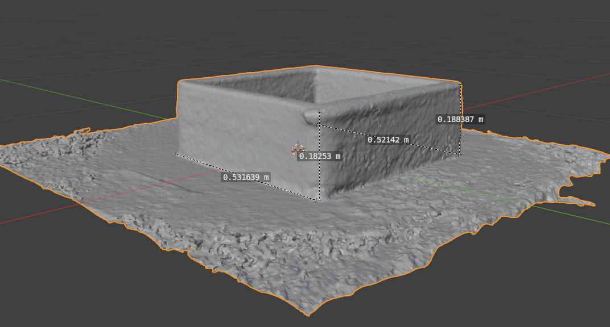
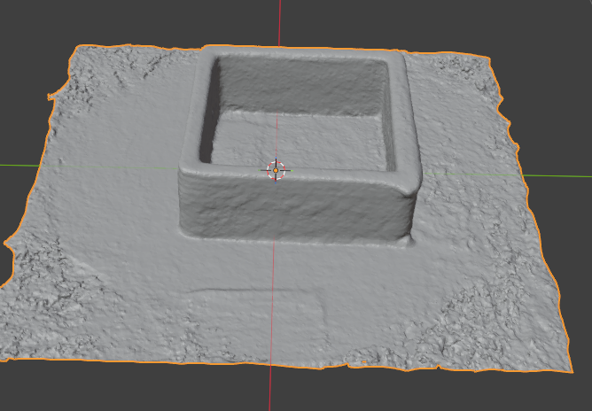
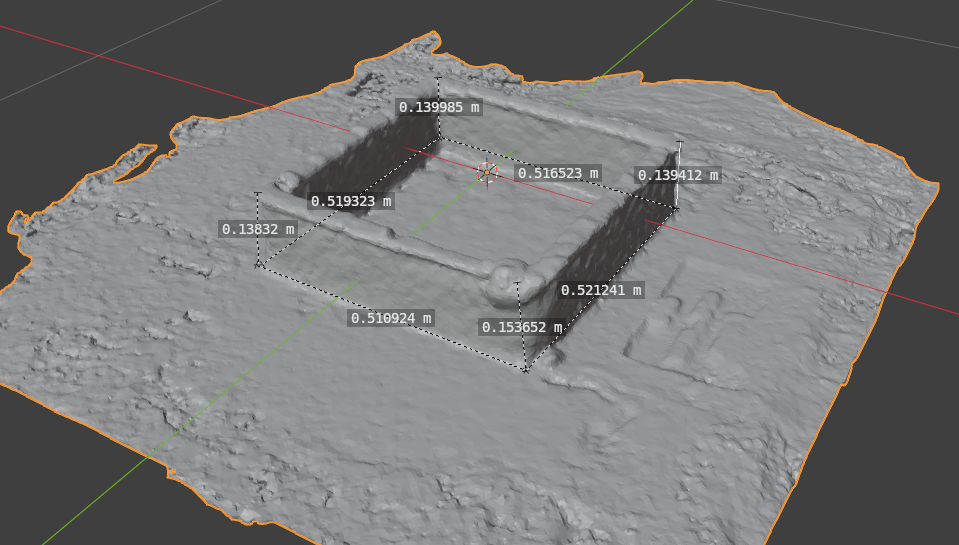
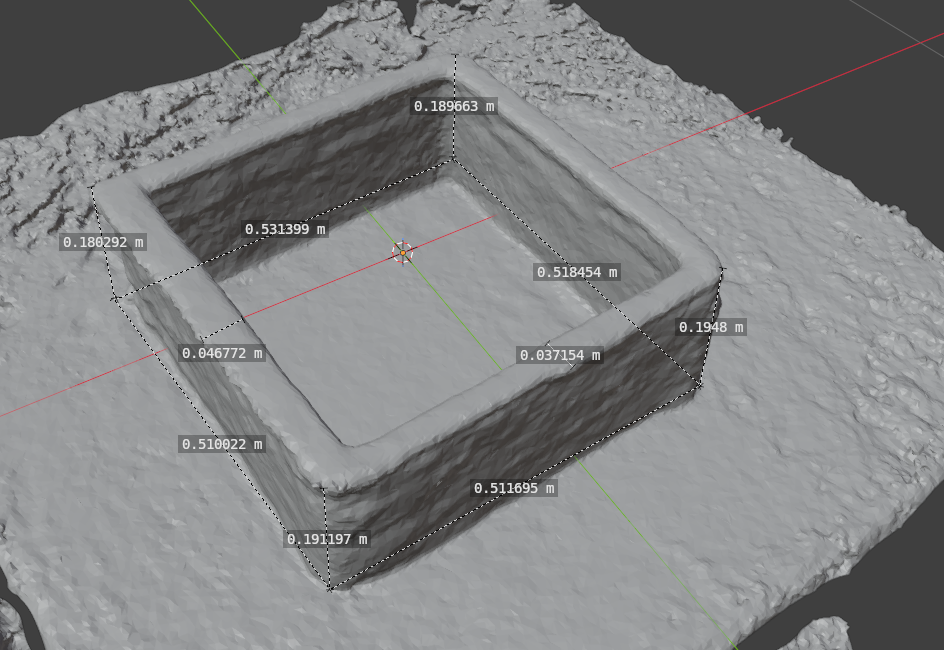
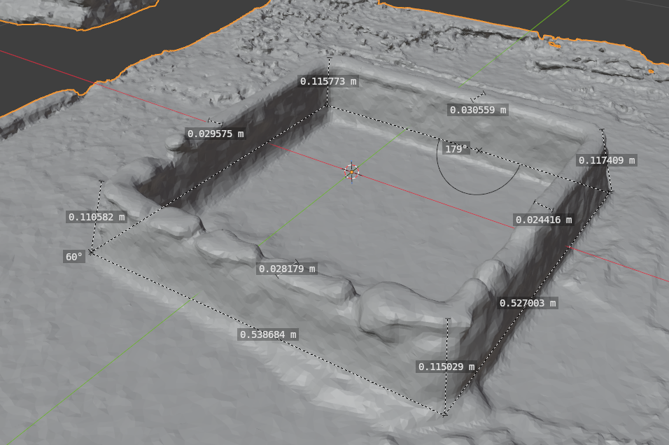

# Blender measurements of physical 3DCP specimens

Polycam GLTF reconstructions were inspected in Blender to record corner heights, side lengths and wall thicknesses for four physical specimens. The workbook records the capture date as **2026-09-14** for all four specimens. These records are separate from the synthetic iOS demonstration assets.

[Download the original measurement workbook](iphone-lidar-3dcp-measurements.xlsx)

## Measurement summary

32 recorded dimensions across P01–P04. Ranges below describe different locations on each specimen, not repeatability or measurement error.

| Specimen | Records | Height range (mm) | Side-length range (mm) | Thickness range (mm) |
| --- | ---: | ---: | ---: | ---: |
| P01 | 4 | 182.530–188.387 | 521.420–531.639 | Not recorded |
| P02 | 8 | 138.320–153.652 | 510.924–521.241 | Not recorded |
| P03 | 10 | 180.292–194.800 | 510.022–531.399 | 37.154–46.772 |
| P04 | 10 | 110.582–117.409 | 527.003–538.684 | 24.416–30.559 |

## Interpretation

- Values are dimensions of Polycam's reconstructed mesh measured in Blender, not raw LiDAR point measurements or outputs of the custom iOS app.
- Workbook values are reported in millimeters; screen values in meters were converted by multiplying by 1,000. Displayed decimal places do not establish accuracy.
- FRONT/BACK/LEFT/RIGHT are provisional labels relative to each specimen's photo, not shared coordinate axes. Endpoints and vertical/horizontal alignment still need verification.
- Reference dimensions are blank, so MAE, RMSE and relative error are not available. The synthetic specimen's nominal dimensions must not be used as reference values for these physical specimens.
- The 32 rows are individual dimensional records, not 32 independent scans. R01 is an identifying label; independent scan repetitions are not established for all specimens.
- Source GLTF and Blender project files are not included in the supplied workbook. The images and records document the earlier measurements; this repository update does not rerun Blender analysis.

## Blender image records

### P01 — dimensional measurements (IMG1)

### P01 — reconstructed shape overview (IMG2; same specimen, not an extra scan)

### P02 — eight dimensions (IMG3)

### P03 — four heights, four side lengths and two thicknesses (IMG4)

### P04 — four heights, two side lengths and four thicknesses (IMG5)

## Complete measurement records

Source: original workbook, `측정기록` sheet, rows 9–40. Blank reference values remain unavailable.

| Specimen | Item | Measurement (mm) | Source row |
| --- | --- | ---: | ---: |
| P01 | H_FRONT | 182.53 | 9 |
| P01 | H_RIGHT | 188.387 | 10 |
| P01 | L_LEFT | 531.639 | 11 |
| P01 | L_RIGHT | 521.42 | 12 |
| P02 | H_LEFT | 138.32 | 13 |
| P02 | H_BACK | 139.985 | 14 |
| P02 | H_RIGHT | 139.412 | 15 |
| P02 | H_FRONT | 153.652 | 16 |
| P02 | L_FRONT | 510.924 | 17 |
| P02 | L_LEFT | 519.323 | 18 |
| P02 | L_BACK | 516.523 | 19 |
| P02 | L_RIGHT | 521.241 | 20 |
| P03 | H_LEFT | 180.292 | 21 |
| P03 | H_BACK | 189.663 | 22 |
| P03 | H_RIGHT | 194.8 | 23 |
| P03 | H_FRONT | 191.97 | 24 |
| P03 | L_FRONT | 510.022 | 25 |
| P03 | L_LEFT | 531.399 | 26 |
| P03 | L_BACK | 518.454 | 27 |
| P03 | L_RIGHT | 511.695 | 28 |
| P03 | T_01 | 46.772 | 29 |
| P03 | T_02 | 37.154 | 30 |
| P04 | H_LEFT | 110.582 | 31 |
| P04 | H_BACK | 115.773 | 32 |
| P04 | H_RIGHT | 117.409 | 33 |
| P04 | H_FRONT | 115.029 | 34 |
| P04 | L_FRONT | 538.684 | 35 |
| P04 | L_RIGHT | 527.003 | 36 |
| P04 | T_01 | 29.575 | 37 |
| P04 | T_02 | 30.559 | 38 |
| P04 | T_03 | 24.416 | 39 |
| P04 | T_04 | 28.179 | 40 |

P04 L_LEFT and L_BACK were not recorded. The 60° and 179° labels in IMG5 are angles and are excluded from the length records.
